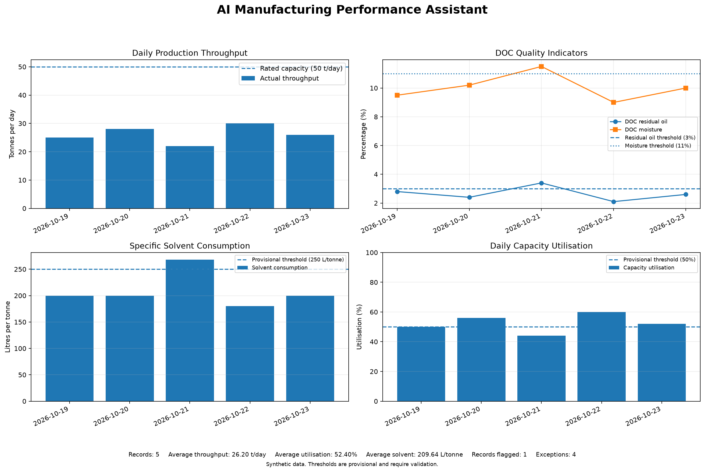

# AI Manufacturing Performance Assistant

**A Python-based manufacturing analytics and decision-support prototype for KPI monitoring, exception detection, investigation recommendations, and what-if scenario analysis.**

## Project Overview

The AI Manufacturing Performance Assistant demonstrates how production data can be analyzed to calculate key performance indicators (KPIs), flag records requiring review, generate investigation guidance, and prepare management reports and visualizations.

The project uses synthetic data based on a fictional palm kernel cake (PKC) solvent extraction manufacturing scenario. It is an educational portfolio project and is not connected to a live manufacturing plant.

## Key Features

- **KPI calculation:** Calculates daily capacity utilization and specific solvent consumption.
- **Exception detection:** Flags high DOC residual oil, high DOC moisture, high solvent consumption, and low capacity utilization.
- **Explanation engine:** Provides explanations for detected exceptions.
- **Investigation recommendations:** Suggests possible causes, recommended checks, evidence to collect, and review priorities.
- **Management reporting:** Produces a structured report combining KPIs, exceptions, explanations, and recommendations.
- **What-if scenario analysis:** Estimates potential solvent savings and optional cost savings under a proposed target.
- **KPI dashboard:** Visualizes throughput, DOC quality indicators, solvent consumption, capacity utilization, and exception summaries.
- **Automated testing:** Uses Python's `unittest` framework to test core calculations, exception rules, reports, recommendations, and dashboard data.

## Dashboard

The dashboard is generated from synthetic production records.



To regenerate the dashboard, run:

```bash
python -m src.dashboard
```

The output is saved to `reports/manufacturing_kpi_dashboard.png`.

## Example Results

The latest verified run analyzed five synthetic production records and reported:

- **Records analyzed:** 5
- **Records requiring review:** 1
- **Exceptions detected:** 4
- **Automated tests passed:** 52

These results describe the current demonstration dataset and test run. They are not measurements of actual plant performance.

## KPI Definitions

### Capacity utilization

Capacity utilization is calculated as:

`(Daily throughput / Rated daily capacity) × 100`

The demonstration uses a rated capacity of 50 tonnes per day.

### Specific solvent consumption

Specific solvent consumption is calculated as:

`Solvent volume used (litres) / Throughput (tonnes)`

The result is expressed in litres per tonne processed. The meaning of the solvent-volume input must be clearly defined—for example, circulating solvent, fresh solvent make-up, or measured solvent loss—before interpreting it as an operational efficiency measure.

## Provisional Exception Rules

| Indicator | Demonstration rule |
|---|---|
| DOC residual oil | Above 3.0% |
| DOC moisture | Above 11.0% |
| Specific solvent consumption | Above 250 L/t |
| Capacity utilization | Below 50% |

These are configurable demonstration thresholds, not approved plant operating limits. Actual limits must be validated against plant procedures, product specifications, and engineering requirements.

## Project Structure

```text
ai-manufacturing-performance-assistant/
├── data/
│   └── sample_production.csv
├── src/
│   ├── dashboard.py
│   ├── kpi_calculator.py
│   ├── exception_detector.py
│   ├── explanation_engine.py
│   ├── recommendation_engine.py
│   ├── production_monitor.py
│   ├── management_report.py
│   └── scenario_analysis.py
├── tests/
├── reports/
│   ├── manufacturing_kpi_dashboard.png
│   ├── management_report.md
│   └── production_exception_report.md
├── results/
├── README.md
└── README_backup.md
```

The tree above highlights the main components; supporting files may also be present.

## Technology

- Python 3
- CSV-based sample data
- `unittest` for automated testing
- Matplotlib and NumPy for dashboard visualization and numerical operations
- Markdown for reporting
- Git and GitHub for version control and portfolio publication

## Setup

Run commands from the project root.

Install the dashboard dependencies if needed:

```bash
python -m pip install matplotlib numpy
```

## How to Run

Generate the KPI dashboard:

```bash
python -m src.dashboard
```

Generate the management report:

```bash
python -m src.management_report
```

Run the full automated test suite:

```bash
python -m unittest discover -s tests -p "test_*.py" -v
```

A successful test run should finish with `OK`. Re-run the tests after making code changes and update the reported test count only after verifying the new result.

## Safety and Limitations

- All production records used in this demonstration are synthetic.
- The project is a decision-support prototype, not a certified industrial monitoring system.
- Exception flags identify records requiring investigation; they do not prove a process fault.
- Recommendations are investigation guidance, not confirmed diagnoses.
- Thresholds require validation against approved plant specifications.
- Scenario savings are illustrative estimates, not guaranteed or verified savings.
- The prototype does not connect to live plant systems, PLCs, SCADA, or enterprise production databases.
- Qualified personnel must review findings before operational decisions are made.

## Future Development

- Improve data validation and reporting.
- Expand dashboard and visualization capabilities.
- Develop AI-assisted explanations with human review.
- Explore secure cloud integration and enterprise manufacturing data workflows.
- Investigate appropriate security and governance controls for future industrial AI applications.

## Project Status

**Working educational prototype.** The dashboard generation and latest recorded 52-test run completed successfully in the development environment. Features and results should be re-verified whenever the code changes.

## Author and Repository

**Author:** Olufemi Adeoye

**GitHub repository:** https://github.com/olufemiadeoye77/ai-manufacturing-performance-assistant
